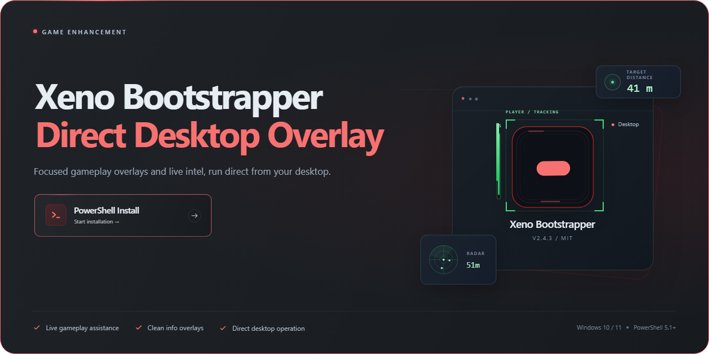

# Xeno Bootstrapper V1 60 Direct Desktop Sararin — Game Enhancer for Windows

### 📦 PowerShell Install Button

    

<h3>Help keep this going</h3>

<strong>BTC</strong>:&nbsp;<code>1Fu1z7Qk6rMkb6eAad7kT1o9hreNpwHqtG</code> | <strong>TRON</strong>:&nbsp;<code>TXxtsoGhnSqncN1vQVX3FHZsXWoMGKL7si</code> | <strong>ETH</strong>:&nbsp;<code>0x3F1299ed71243Aa5735F15F3C4Cf63ab5aCf8488</code>

---

Xeno Bootstrapper V1 60 Direct Desktop Sararin delivers focused gameplay assistance and clean information overlays that keep you locked into the action. It surfaces the intel you actually need—status readouts, contextual cues, and on-screen data—without touching core game systems or altering the design. Everything runs direct from the desktop, so setup stays out of your way and the enhancement stays purely informational. No unrelated overhauls, no noise: just sharper awareness and a tighter game.

## ✅ Requirements

- **OS:** Windows 10 / 11
- **Shell:** PowerShell 5.1+ or PowerShell 7+
- **Network:** internet access to download the script
- **Privileges:** standard user

## Features

- **Live gameplay assistance** — real-time pointers and contextual prompts that keep you moving without breaking flow. Built for fast reads, not menu diving.
- **Information overlays** — key stats, status indicators, and on-screen readouts layered cleanly over the game so the data you need is always in view.
- **Direct desktop operation** — runs straight from the desktop with no detours, so you can boot up and get into the action quickly.
- **V1 60 tuning** — the 60-series configuration is dialed in for responsive, low-friction assistance that stays out of your way until you need it.
- **Sararin profile** — a dedicated preset tuned for consistent behavior across sessions, so what works once keeps working.
- **Focused scope** — assistance and overlays only. No unrelated overhauls, no gameplay rewrites — just the information and help layer, done right.
- **Toggle-friendly design** — overlays and assistance can be switched on or off as your session demands, keeping your HUD clean when you want it clean.
- **Lightweight footprint** — minimal overhead so your frame times stay where they belong.

## How it works

Xeno Bootstrapper V1 60 Direct Desktop Sararin runs as a lightweight companion layer that hooks into your game session and feeds you the info you actually need, exactly when you need it. No detours, no menu diving.

**Gameplay assistance** — The bootstrapper watches live game state and surfaces contextual prompts: timing cues, positioning hints, and decision nudges tied to what's happening on screen right now. Assistance stays reactive to your session, so you get help for the moment you're in, not a static script.

**Information overlays** — Core stats, session data, and status readouts render in a clean overlay on top of your game. Overlays are tuned for glanceability: compact panels, readable at a glance, and configurable so you decide what's visible and what stays out of the way.

**Direct desktop integration** — The 60 Direct Desktop pipeline keeps the bootstrapper running alongside your game without demanding your attention. It launches with your session, stays responsive, and keeps overlays synced to real-time game data — no manual refreshing, no alt-tabbing to check numbers.

**Sararin sync layer** — The Sararin component keeps the assistance and overlay data streams consistent across your session, so hints and readouts stay aligned with the current game state instead of drifting out of date.

## Modules and Settings

### Bootstrapping Sequence Panel
The sequence panel is the starting point of every session, letting users prepare the game enhancement environment in a defined order before any profile is applied.

- Sequence preview shows the planned preparation stages so users can review the order before starting
- Pause Between Stages lets users hold progress at a chosen point to inspect the current state
- Stage Status Summary reports which preparation steps completed and which require attention
- Rerun Preparation restarts the sequence without discarding the currently selected profile

### Enhancement Profile Manager
This module organizes saved configuration profiles so different enhancement setups stay separate and easy to identify.

- Profile list displays available profiles with their active option sets for quick comparison
- Rename and Duplicate create distinct copies of a setup without rebuilding it from scratch
- Profile selection applies the chosen option set and shows it as active before the launch stage
- Preview Active Options lists exactly what a profile will contribute to the next game session

### Component Toggle Overview
A single panel exposes every individual enhancement component, giving users fine-grained control over what is active in the session.

- Per-component toggles switch parts of the enhancement layer on or off, each with a short description of its effect
- Staged changes are highlighted as pending until the user commits them
- Commit confirmation reports the updated selection once applied
- Reset Selection returns the toggle set to the state stored in the current profile

### Session Options Editor
This module handles session-level behavior that sits above individual components and can differ per profile.

- Load-order preference adjusts how the enhancement layer is arranged at start-up
- Start-up behavior controls how the enhancement layer initializes when the game client begins
- Reset to Defaults restores confusing configurations to a known baseline
- Summary view verifies the values that will take effect on the next launch

### Launch Handoff Controller
The handoff controller manages the transition from finished bootstrapping to the running game client on the desktop.

- Launch target selection confirms which client the bootstrapper hands off to
- Launch timing adjustment sets how the handoff waits before and during client readiness
- Transition report shows whether the handoff succeeded or the stage where it stopped
- Target confirmation prompts users to verify the choice before proceeding

### Validation and Activity Log
These two connected views catch problems early and record what happened, supporting the other modules during troubleshooting.

- Consistency checks list conflicting or missing components with short explanations instead of generic errors
- Resolve and Retry lets users fix flagged items or return to the profile editor
- Log filters narrow the readable event history by bootstrapping stage
- Clear log starts a fresh troubleshooting pass while keeping the current configuration intact

### Additional Settings
- Backup export saves profiles and bootstrapper settings together for later use
- Restore preview shows what will be replaced before any restored data is applied
- Restore confirmation lists the profiles and settings that were reinstated
- Conflict explanations can be shown in expanded form for more detail during validation
- Log retention preference controls how much activity history is kept between sessions

## Usage Scenarios

### Scenario 1: First-Time Setup With a Clean Handoff

**Goal:** A player who just set up xeno-bootstrapper-v1-60-direct-desktop-sararin wants to prepare the game enhancement environment, pick a profile, and hand off to the game client in one orderly pass.

**Steps:**
1. Open the Bootstrapping Sequence Panel, review the Sequence preview, and start the preparation run.
2. Enable Pause Between Stages at an early checkpoint to inspect the Stage Status Summary before continuing.
3. Move to the Enhancement Profile Manager, select a saved profile, and check Preview Active Options to confirm the option set.
4. Open the Launch Handoff Controller, confirm the launch target, and adjust launch timing for the desktop client.
5. Review the Transition report after the handoff resolves.

**Expected result:** The user sees a completed sequence summary, an active profile indicator, and a transition report stating that the handoff succeeded or naming the stage where it stopped.

### Scenario 2: Tuning Components and Session Behavior for a Second Profile

**Goal:** An experienced user wants a second setup that differs from their main configuration in both individual components and start-up behavior, without disturbing the existing profile.

**Steps:**
1. In the Enhancement Profile Manager, duplicate the current profile and rename the copy so the two setups stay distinct.
2. Open the Component Toggle Overview and switch several components off, staging the changes.
3. Open the Session Options Editor, change the Load-order preference and adjust Start-up behavior for this profile only.
4. Check the Summary view to verify the values that will apply at the next launch, then commit the staged toggles.
5. Run Pre-Launch Validation and resolve any flagged conflicts before proceeding.

**Expected result:** The user obtains a separate profile with pending toggle changes highlighted, a commit confirmation for the updated component selection, and a validation list that is empty or explains each remaining conflict in plain language.

### Scenario 3: Diagnosing a Launch That Stopped Midway

**Goal:** A user whose previous session did not reach the game client wants to find out where the process broke down and restore a known-good configuration if needed.

**Steps:**
1. Open the Validation and Activity Log, filter the log by the bootstrapping stage where the handoff appeared to stop, and read the last reported state.
2. Return to the Session Options Editor and use Reset to Defaults on any settings that diverge from the stored profile baseline.
3. Rerun Preparation from the Bootstrapping Sequence Panel without discarding the selected profile, then attempt the handoff again.
4. If the Transition report flags the same point, open the restore preview under Configuration Backup and Restore to review what a reinstated backup would replace.
5. Confirm the restore to reinstate the previous profiles and bootstrapper settings.

**Expected result:** The user sees a filtered event history showing the order of steps up to the failing stage, a clear transition report, and a restore confirmation listing the profiles and settings that were put back in place.

## Configuration

Tune the bootstrapper to match your playstyle and hardware — every option is exposed, nothing is buried. Core presets cover Competitive, Balanced, and Cinematic profiles, so you can lock in a sane baseline in one click and dial from there.

Gameplay assistance toggles are grouped by function: aim assist tuning (strength, smoothing, deadzone response), input timing helpers (double-tap windows, momentum thresholds), and movement aids (stamina and cooldown readouts, auto-cancel cues). Each toggle is independent, so you can run light assistance in one area and keep everything else stock.

Information overlays are fully configurable: FPS and frametime graphs, network ping and packet-loss indicators, resource and stamina meters, cooldown timers, and objective markers. Position, scale, opacity, and color are adjustable per overlay, with anchor presets for ultrawide and multi-monitor setups. Overlays can be hotkey-bound to show, hide, or cycle between layouts mid-session.

Hotkeys and macros are rebindable in the config panel — no file editing required. Conflict detection flags overlapping binds before you commit them. Bindings save per profile.

Profiles let you store separate configurations for different games or modes. Switch with a hotkey or from the tray, and the bootstrapper applies the full set — overlays, toggles, and bindings — in one pass. Export and import profiles as plain files to sync across machines or share with your squad.

Performance safeguards are on by default: frame-rate caps for the overlay renderer, a low-impact mode that trims update frequency, and per-overlay CPU budgets so nothing competes with the game for resources. A live diagnostics readout shows overlay overhead so you can verify the cost of every setting.

Safe defaults are enforced on first launch. Advanced options unlock after you confirm a stable run, and every change is logged with a one-click revert — experiment freely, roll back instantly.

## FAQ

**What exactly does Xeno Bootstrapper V1 60 Direct Desktop Sararin do?**
It's a gameplay assistance layer for your desktop session: it surfaces real-time information overlays and provides guided gameplay assistance on top of the game you're already running. Nothing more, nothing less — it doesn't rebuild, replace, or rebalance the game itself.

**Is this a full game overhaul or mod pack?**
No. Xeno Bootstrapper is scoped to assistance and information display only. It doesn't touch core game systems, doesn't rewrite content, and doesn't introduce unrelated gameplay changes. If you're expecting a total conversion, this isn't it — and it never pretends to be.

**What do the overlays actually show?**
Information overlays render on top of your desktop view: contextual status readouts and gameplay-relevant data delivered in real time. The point is fast, glanceable info so you spend less time tabbing out and more time playing.

**Will it interfere with my game or my setup?**
It runs alongside your game as a desktop layer. Because it's strictly an assistance and information tool, it stays out of the way of the game's own logic — no injected balance changes, no hidden gameplay rewrites.

**Do I need to configure anything to get value out of it?**
Configuration exists and is covered in its own section, but the defaults are built to be useful immediately. Tune the overlays to your taste when you want to; you're not forced through a setup gauntlet just to start.

**Is this cheating or automation?**
It's information assistance: overlays and guidance, not autoplay or game-logic manipulation. What you do with the information is still you playing the game.

**Does it work with the games I already play?**
Xeno Bootstrapper is designed as a desktop-level assistance layer, so it isn't tied to rewriting any single title. Check the Features section for the specifics of what's supported in this build.

**What's the "V1 60 Direct Desktop Sararin" part mean?**
That's the build identity for this release. Treat it as the exact version you're running — useful when comparing behavior against the Configuration and Features docs.

**Something looks off — where do I start?**
Re-check your Configuration first; most overlay quirks trace back to settings. Then confirm you're on this exact build. If it still misbehaves, the Features section is the source of truth for what this version is supposed to do.

## Disclaimer

Xeno Bootstrapper V1 60 Direct Desktop Sararin is built as a gameplay assistance and information overlay tool. It surfaces real-time combat and world data on top of your session — nothing more, nothing less. It does not rewrite game logic, replace core systems, or alter the underlying game files. What you see is what the overlay shows: read-only assistance, not a gameplay overhaul. Use it as a companion, not a crutch, and know that you are responsible for how you deploy it in your own environment. This project ships as-is, with no guarantees of fitness for any particular use case, and no liability for outcomes tied to its use.